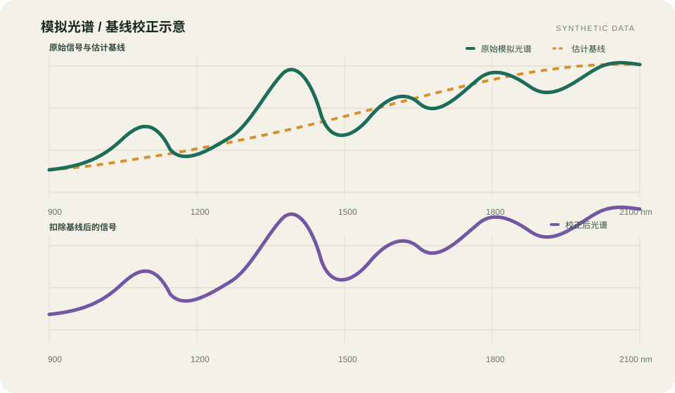
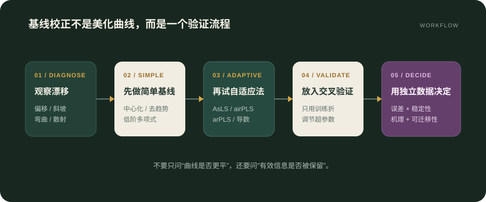

近红外光谱中的基线漂移通常表现为整条曲线的平移、倾斜或缓慢弯曲。它可能来自散射差异、样品装填、光程变化、仪器响应和温度等因素。如果不加辨别地把所有低频变化都“压平”，也可能连同与浓度或物理性质相关的信息一起删除。因此，基线校正的目标不是让曲线看起来更整齐，而是尽量分离干扰背景与有效化学信号。

> [!NOTE]
> 本文中的光谱图为教学用模拟数据，用来说明基线估计与扣除过程，不代表真实样品或算法性能。正式建模时应在独立验证集上比较校正前后的结果。

## 1. 基线问题可以怎样表示

把观测光谱记为 $\mathbf y$，一个常用的概念模型是：

$$
\mathbf y = \mathbf s + \mathbf b + \boldsymbol{\varepsilon}
$$

其中，$\mathbf s$ 是希望保留的有效光谱，$\mathbf b$ 是缓慢变化的基线，$\boldsymbol{\varepsilon}$ 是随机噪声。校正的关键在于估计 $\hat{\mathbf b}$，再计算：

$$
\mathbf y_{\mathrm{corr}}=\mathbf y-\hat{\mathbf b}
$$

这个表达式看似简单，真正困难的是：宽而缓慢的吸收带与基线在形状上可能相似。算法越“积极”，越可能同时削弱真实谱带。

## 2. 常见方法的思路与适用场景

| 方法 | 核心假设 | 优点 | 需要警惕 |
| --- | --- | --- | --- |
| 常数或线性去趋势 | 基线主要是偏移或斜坡 | 快速、参数少、容易解释 | 难以处理弯曲背景 |
| 多项式拟合 | 基线可由低阶平滑曲线表示 | 直观，适合基线区明确的光谱 | 阶数过高易追随吸收峰；锚点选择影响大 |
| Rubber band / 凸包 | 基线可由谱图下包络近似 | 对部分具有清晰谷底的谱图有效 | 端点和宽峰可能造成偏差 |
| AsLS | 峰与基线可通过非对称权重分开 | 自动化程度高，应用广 | 平滑参数 $\lambda$ 与不对称参数 $p$ 需要调节 |
| airPLS / arPLS | 根据残差迭代更新权重 | 减少人工选择基线点 | 迭代和超参数仍需验证，不能替代机理判断 |
| 一阶或二阶导数 | 缓慢背景可被微分削弱 | 常与 Savitzky–Golay 平滑结合 | 放大高频噪声；严格说不是显式估计基线 |

### 2.1 去趋势与多项式拟合

当漂移近似为整体偏移或斜坡时，低阶多项式往往已经足够。设波长位置为 $x_i$，可以在无明显吸收的基线点上拟合：

$$
b(x)=\sum_{k=0}^{m}a_kx^k
$$

通常应从较低阶数开始。若为了贴合所有局部起伏而不断提高 $m$，拟合曲线便可能吞掉宽吸收带。与其单纯追求较小的拟合残差，不如检查残差中是否仍保留稳定的化学结构。

### 2.2 惩罚最小二乘家族

AsLS、airPLS 和 arPLS 都可以放在“拟合误差 + 曲率惩罚”的框架下理解。以二阶差分矩阵 $\mathbf D$ 为例：

$$
\min_{\mathbf z}\;(\mathbf y-\mathbf z)^{\mathsf T}\mathbf W(\mathbf y-\mathbf z)
+\lambda\lVert\mathbf D\mathbf z\rVert_2^2
$$

$\mathbf z$ 是待估计基线，$\mathbf W$ 是逐点权重矩阵。第一项让基线靠近观测数据，第二项限制基线的弯曲程度。$\lambda$ 越大，得到的基线通常越平滑。不同算法的主要区别之一，是如何依据正负残差更新 $\mathbf W$，使吸收峰或发射峰不至于把基线向上或向下拉偏。

- **AsLS** 使用不对称权重，适合峰主要位于基线同一侧的情况。
- **airPLS** 根据负残差等信息迭代重加权，减少对峰区域的依赖。
- **arPLS** 利用负残差的统计特征构造平滑的权重更新，以减弱对手动不对称参数的依赖。

### 2.3 导数预处理

一阶导数能消除常数偏移，二阶导数能进一步削弱线性趋势。实际中常用 Savitzky–Golay 局部多项式来同时平滑并求导。窗口过窄容易放大噪声，窗口过宽又会钝化窄谱带，所以窗口长度、阶数和导数阶次应作为建模管线的一部分共同验证。

## 3. 一个稳妥的选择流程

1. **先观察漂移形态。** 区分整体偏移、近似线性斜坡、平滑弯曲以及由散射引起的乘性变化。
2. **建立最简单的基线。** 先比较不处理、中心化、线性去趋势和低阶多项式，避免一开始就使用复杂算法。
3. **再测试自适应方法。** 对弯曲背景明显的数据，比较 AsLS、airPLS 或 arPLS，并记录全部超参数。
4. **把校正放进交叉验证。** 所有预处理参数只能用训练折确定，避免测试数据参与选择。
5. **同时检查光谱与模型。** 不仅看曲线是否“平”，还要看重复性、校正集误差、独立验证误差和跨批次稳定性。

## 4. 不宜忽略的几个问题

- 基线漂移若与样品粒径、密度或光程相关，它有时也携带与目标属性间接相关的信息；删掉它可能让同批数据表现更纯净，却降低跨场景解释力。
- SNV、MSC 主要针对散射及尺度差异，和“直接估计一条加性基线再相减”不是同一件事，虽然它们在实际效果上可能有重叠。
- 比较算法时应固定数据划分与评价指标。否则，数据划分带来的波动可能大于预处理方法之间的差异。
- 预处理必须在训练集和预测集上以完全一致的规则执行；涉及拟合的参数不能从完整数据集中预先估计。

## 5. 小结

基线校正没有对所有近红外数据都最优的单一算法。简单偏移优先考虑中心化或去趋势，平滑弯曲背景可尝试惩罚最小二乘家族，导数法则适合在关注局部谱形时使用。最终选择应由测量机理和独立验证结果共同决定，而不是由“校正后的曲线是否更平滑”决定。

## 参考资料

1. Eilers, P. H. C. *A Perfect Smoother*. Analytical Chemistry, 2003. [DOI: 10.1021/ac034173t](https://doi.org/10.1021/ac034173t)
2. Zhang, Z.-M., Chen, S., Liang, Y.-Z. *Baseline correction using adaptive iteratively reweighted penalized least squares*. Analyst, 2010. [DOI: 10.1039/B922045C](https://doi.org/10.1039/B922045C)
3. Baek, S.-J. et al. *Baseline correction using asymmetrically reweighted penalized least squares smoothing*. Analyst, 2015. [DOI: 10.1039/C4AN01061B](https://doi.org/10.1039/C4AN01061B)
4. Savitzky, A., Golay, M. J. E. *Smoothing and Differentiation of Data by Simplified Least Squares Procedures*. Analytical Chemistry, 1964. [DOI: 10.1021/ac60214a047](https://doi.org/10.1021/ac60214a047)
